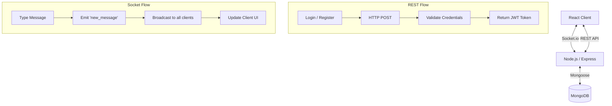

<div align="center">

# ✦ Chatty ✦

A sophisticated, real-time messaging application designed with a minimalist, monochrome aesthetic.
Built with modern web technologies to deliver a seamless, premium communication experience.

**[Live Demo](https://chatty-six-flax.vercel.app/)** • **[Report Bug](#)** • **[Request Feature](#)**

[](https://reactjs.org/)
[](https://nodejs.org/)
[](https://socket.io/)
[](https://mongodb.com/)
[](https://vitejs.dev/)

</div>

---

## ✧ About The Project

Chatty is a high-performance, real-time global chat application. Conceived with a focus on **Intelligent Minimalism** and a premium monochrome design system (inspired by Notion and macOS), it strips away visual clutter to provide a focused, elegant messaging environment. 

Proudly built as part of the **[The Odin Project](https://www.theodinproject.com/)** curriculum.

### Key Features

- **Real-Time Synchronization** — Instant, latency-free message delivery powered by WebSocket technology.
- **Global Communications** — A unified, global chat room architecture where all users converge.
- **Secure Authentication** — Robust JWT-based authentication flow with bcrypt password hashing.
- **Premium Monochrome UI** — A meticulously crafted, dark-themed interface prioritizing typography and whitespace.
- **Responsive Design** — Flawless execution across desktop, tablet, and mobile environments.

---

## ⚡ Tech Stack

**Client-Side**
* React 18 (Functional Components, Hooks)
* Vite (Next-generation frontend tooling)
* React Router (Declarative routing)
* Lucide React (Premium, consistent iconography)

**Server-Side**
* Node.js & Express.js
* Socket.io (Bi-directional real-time communication)
* MongoDB & Mongoose (Persistent, scalable data storage)
* JSON Web Tokens (Stateless, secure session management)

---

## 🏁 Quick Start

To get a local copy up and running, follow these steps.

### Prerequisites

* Node.js (v18.0.0 or higher)
* npm (v9.0.0 or higher)
* MongoDB database (Local or Atlas)

### Installation

1. **Clone the repository**
   ```bash
   git clone https://github.com/yourusername/Chatty.git
   cd Chatty
   ```

2. **Install Backend Dependencies**
   ```bash
   cd backend
   npm install
   ```

3. **Install Frontend Dependencies**
   ```bash
   cd ../frontend
   npm install
   ```

4. **Environment Configuration**
   
   Create a `.env` file in the `backend/` directory:
   ```env
   PORT=8000
   JWT_SECRET=your_super_secret_key_here
   MONGODB_URI=your_mongodb_connection_string
   ```

   Create a `.env` file in the `frontend/` directory:
   ```env
   VITE_API_URL=http://localhost:8000
   ```

5. **Initialize the Application**
   
   Start the backend server (Terminal 1):
   ```bash
   cd backend
   npm start
   ```

   Start the frontend development server (Terminal 2):
   ```bash
   cd frontend
   npm run dev
   ```

6. Open your browser and navigate to `http://localhost:5173`

---

## 🏛️ System Architecture

Chatty utilizes a decoupled client-server architecture with dual communication channels: REST for standard operations and WebSockets for real-time state synchronization.

### Data Flow



### Database Schema

<details>
<summary><b>View Models</b></summary>

**User Model**
```javascript
{
  username: { type: String, required: true, unique: true },
  password: { type: String, required: true } // bcrypt hashed
}
```

**Message Model**
```javascript
{
  username: { type: String, required: true },
  text: { type: String, required: true },
  createdAt: { type: Date, default: Date.now }
}
```
</details>

---

## 📡 API Reference

### REST Endpoints

| Method | Endpoint | Description | Payload |
|--------|----------|-------------|---------|
| `POST` | `/register` | Register a new user | `{ name, password }` |
| `POST` | `/login` | Authenticate existing user | `{ name, password }` |
| `GET`  | `/messages` | Retrieve message history | *Requires Auth Header* |

### WebSocket Events

| Event | Direction | Payload | Description |
|-------|-----------|---------|-------------|
| `new_message` | Client → Server | `{ username, text }` | Broadcasts a new message |
| `receive_message`| Server → Client | `{ username, text, createdAt }` | Receives broadcasted message |
| `connect` | Bi-directional | *Socket ID* | Establishes real-time link |
| `disconnect` | Bi-directional | None | Terminates real-time link |

---

## 🔐 Security Considerations

- **Stateless Authentication:** JWT implementation ensures secure, scalable session management.
- **Cryptographic Hashing:** Passwords are never stored in plaintext; bcrypt with dynamic salting is strictly enforced.
- **CORS Policies:** Cross-Origin Resource Sharing is restrictively configured for specified frontend domains.
- **Input Sanitization:** Backend validation prevents injection attacks and ensures data integrity.

---

## 🌍 Deployment

Chatty is designed for modern cloud infrastructure.

**Production Environment Variables:**
- **Backend:** `PORT`, `JWT_SECRET`, `MONGODB_URI`, `FRONTEND_URL`
- **Frontend:** `VITE_API_URL`

*Recommended Hosting:* Render or Railway (Backend), Vercel or Netlify (Frontend).

---

<div align="center">
  <br />
  <p>Designed and built with 🖤</p>
</div>
